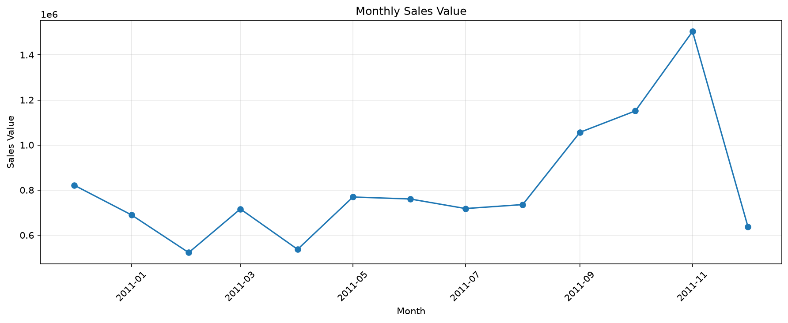
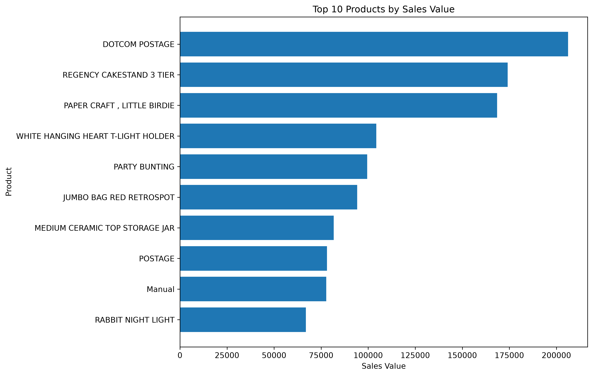
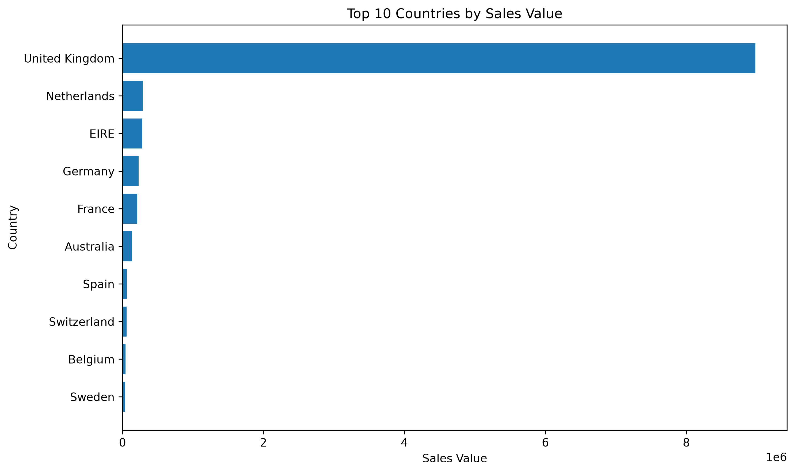
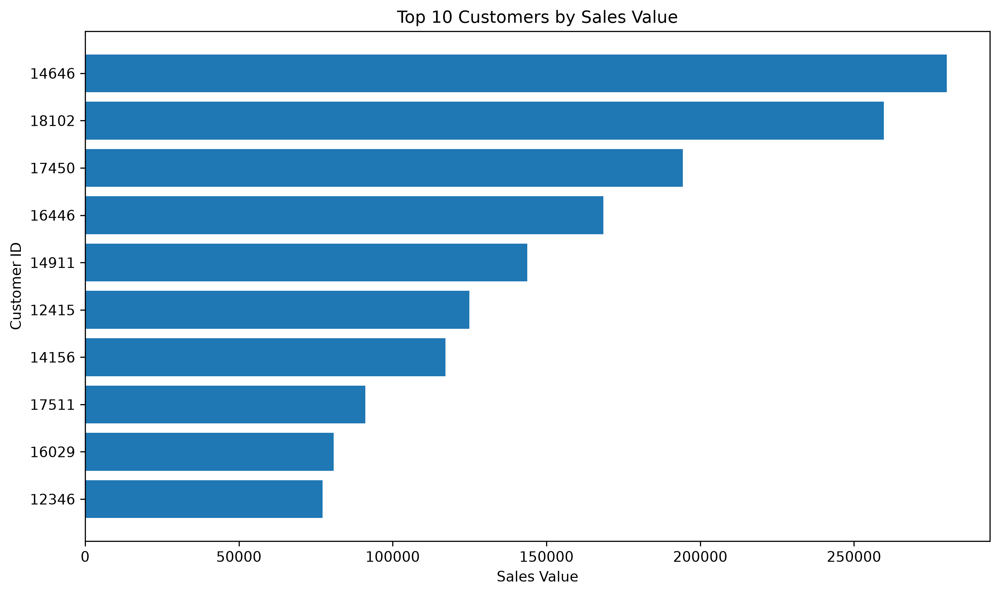
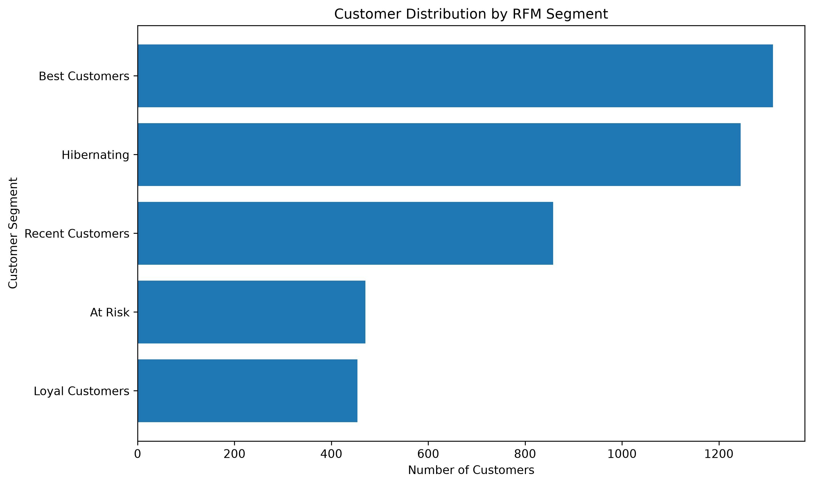
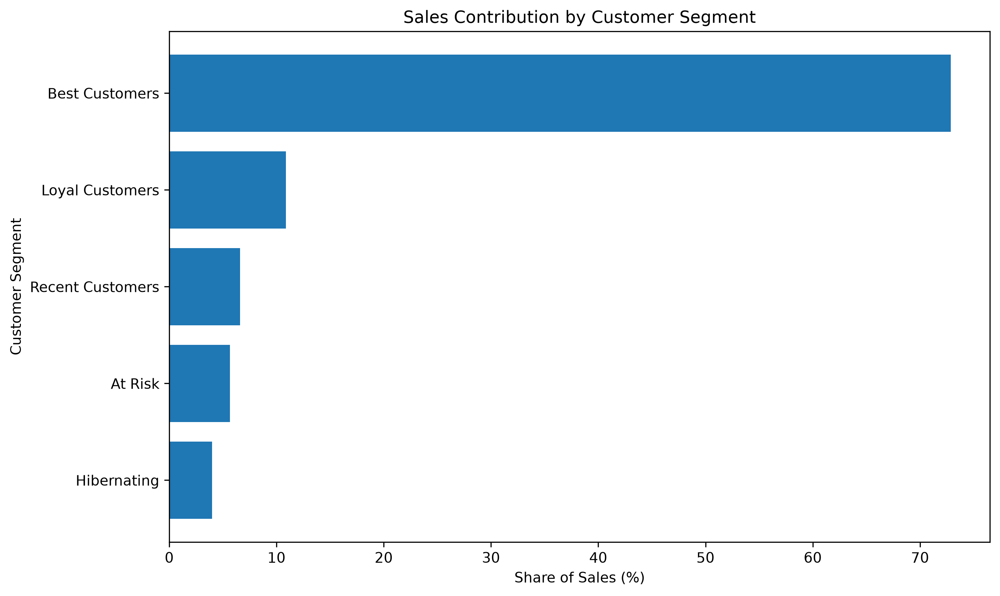

Online Retail Data Analysis Report

1. Project Overview

Objective

The objective of this project is to analyze online retail transactions to understand sales trends, product performance, geographic sales distribution, customer concentration, and customer purchasing behavior.

The analysis aims to identify actionable business insights and opportunities to improve customer retention and sales performance.

Dataset

The project uses the Online Retail dataset from the UCI Machine Learning Repository. It contains transactional records from a UK-based online retailer covering December 2010 to December 2011.

Tools and Technologies

    Python
    pandas
    Matplotlib
    Jupyter Notebook

Analytical Scope

    Data quality assessment and cleaning
    Monthly sales trend analysis
    Product performance analysis
    Sales comparison by country
    Customer sales concentration
    RFM customer segmentation

Important Metric Definition

Sales value is calculated as Quantity × UnitPrice. Unless otherwise stated, sales and customer analyses use positive-quantity transactions. These figures should not be interpreted as profit or net sales after returns.

2. Key Findings

2.1. Monthly Sales Trends

November 2011 was the strongest full month in the analyzed period, with approximately 1.50 million in sales value from positive-quantity transactions.

Sales value increased by approximately 42% between September and November 2011.

December 2011 covers only the period through December 9, so its results are not directly comparable with full months.

2.2. Product Performance

PAPER CRAFT, LITTLE BIRDIE was among the leading products by both sales value and units sold.

REGENCY CAKESTAND 3 TIER generated approximately 174 thousand in sales value.

Product rankings should be interpreted carefully because the dataset also contains non-merchandise entries, such as postage and manual adjustments.

2.3. Geographic Sales Distribution

The United Kingdom generated approximately 8.98 million in sales value from positive-quantity transactions.

It accounted for approximately 84.6% of sales value across all countries in this analysis.

The Netherlands, EIRE, Germany, and France were among the next-largest markets by sales value.

2.4. Customer Sales Concentration

The top 10 customers contributed approximately 17.3% of sales value among customers with an identified CustomerID.

The top 20 customers contributed approximately 23.9%.

This indicates that high-value customers make a meaningful contribution, although sales are not concentrated in a single customer alone.

2.5. RFM Customer Segmentation

Five customer segments were identified using recency, frequency, and monetary value.

    Best Customers: 1,312 customers, representing 30.24% of identified customers and contributing 72.88% of their sales value.

    Loyal Customers: 454 customers, contributing 10.88% of sales value.

    Recent Customers: 858 customers, representing 19.77% of customers.

    At Risk: 470 customers, potentially suitable for targeted re-engagement campaigns.

    Hibernating: 1,245 customers, representing 28.69% of customers but contributing only 3.98% of sales value.

3. Business Recommendations

Retain high-value customers. Explore loyalty benefits and personalized offers for the Best Customers segment.

Encourage repeat purchases. Test relevant product recommendations or follow-up campaigns for Recent Customers.

Test re-engagement campaigns. Start with a small, measurable campaign for At Risk customers and evaluate the results before scaling.

Use cost-effective reactivation strategies. Given the low average sales value of Hibernating customers, test low-cost approaches before investing heavily.

Investigate geographic opportunities. Since sales are heavily concentrated in the United Kingdom, assess the potential to grow in other markets.

4. Limitations

The dataset covers a limited historical period, from December 2010 to December 2011.

December 2011 is incomplete in the available data.

CustomerID is missing for a substantial portion of transactions, so customer-level analyses exclude those records.

Sales value is not equivalent to profit.

Positive-quantity transaction analyses do not deduct returns or cancellations.

RFM segment names depend on the scoring rules and are analytical categories, not confirmed measures of customer loyalty or churn.

5. Conclusion

The analysis shows that sales were concentrated in the United Kingdom and that November 2011 was the strongest full month in the observed period. Product performance varied substantially, while RFM segmentation revealed a high-value customer group responsible for a large share of identified-customer sales.

The results suggest opportunities to retain high-value customers, encourage repeat purchases, and test targeted re-engagement campaigns. Further analysis would be needed to measure profitability, customer lifetime value, and the effectiveness of these interventions.